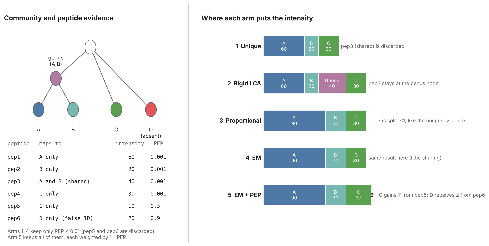

# 3. Materials and Methods

## 3.1 Dataset

The mock microbial communities of @kleiner2017 (PRIDE PXD006118) were used because their composition is known. The communities contain 30 strains (bacteria, archaea, one eukaryote and five bacteriophages), prepared in three designs:

-   **Constant (C)**: equal cell number per strain.
-   **Protein (P)**: equal protein amount per strain.
-   **Uneven (U)**: per-strain amounts spanning roughly three orders of magnitude.

Four strains (DVH, Ne1, Nu1, Nm1) were not added in designs C and P. These eight strain–design combinations are true negatives: any abundance assigned to them is false signal.

The 460 min one-dimensional liquid chromatography runs were used: 3 designs × 4 biological replicates × 2 technical replicates = 24 RAW files, acquired on a Q Exactive Plus in a single batch and in a randomized block design. The technical replicates are two injections of the same sample. The biological replicates are four mixtures assembled separately from frozen aliquots of a single culture of each organism [@kleiner2017], so they reflect the variation of assembly, preparation and measurement, not the biological variation between communities.

The expected proportion of strain *s* in design *c*, *e*ₛ,ᶜ, is its added protein amount divided by the total protein added in that design, so that Σₛ *e*ₛ,ᶜ = 1. Strains are referred to by the codes of @kleiner2017.

## 3.2 Identification and error probabilities

RAW files were processed with quantMS 1.7.0 [@dai2024], an automated OpenMS-based pipeline that takes raw data to identified and quantified peptides. For label-free DDA data, quantMS converts the RAW files to mzML, adds decoy sequences to the database, searches the spectra with Comet, rescores the identifications with Percolator, filters by FDR and quantifies the MS1 intensity of each peptide. Of its outputs, only the Triqler input table was used, which has one row per peptide (with its charge and modifications) in each run, with the score of its best PSM (parameters in Supplementary material II). Hereafter, each row of this table (a peptide with its charge in one run) is called an *identification*.

This workflow is configured with an SDRF-Proteomics file [@dai2021sdrf], a standard format recommended by PRIDE that describes in a table each RAW file with its sample, design, replicates and search parameters. Because the experiment of @kleiner2017 predates this format, the file was built manually from the original description (Supplementary material I).

Spectra were searched against the protein database published by @kleiner2017, which contains the proteomes of the community strains and common laboratory contaminant proteins (cRAP). quantMS added reversed decoy sequences to estimate the FDR (target–decoy search). Trypsin, cysteine carbamidomethylation as a fixed modification, methionine oxidation and protein N-terminal acetylation as variable modifications, and tolerances of 10 ppm for the precursor and 0.1 Da for the fragments were used. For each identification, the table includes the run, the MS1 intensity, the peptide sequence, the proteins that contain it, whether it is a decoy, and an identification score equal to 1 − PEP, where the PEP is the posterior error probability assigned by Percolator at the level of individual spectra; the score ranges from 0 to 1 and is higher for more reliable identifications.

The search was exported in two ways from the same RAW files:

-   **Standard table**: with the default quantMS filter (FDR ≤ 1 %). It contains 554,725 identifications, almost all of high confidence (minimum score 0.900).
-   **Unfiltered table**: with every quantMS FDR filter disabled. It contains about 2.96 million identifications, targets and decoys, with scores across the full 0–1 range.

Unless stated otherwise, results come from the unfiltered table.

**PEP estimation.** Percolator computes the PEP of each spectrum separately, but each row of the table summarises a peptide in one run. These probabilities cannot be transferred directly from one level to the other [@granholm2013]: a peptide present in the sample is usually identified by several spectra, whereas incorrect identifications are spread over many different peptides, so that reducing spectra to peptides increases the fraction of incorrect identifications. Percolator's PEP therefore underestimates the errors at the level of the table rows. In the unfiltered table, for example, the target identifications with score ≥ 0.99 add up to a Percolator PEP equivalent to about 250 incorrect identifications, whereas there are 3,186 decoys in that range. Following the procedure recommended at the peptide level, which is to reduce first and estimate afterwards [@granholm2013], the PEP of each identification was re-estimated from the decoys of the table itself with equation (1):

$$ \mathrm{PEP}(s) = \frac{h(s)}{1 - h(s)} \qquad\qquad (1) $$

where *s* is the identification score and *h*(*s*) is the probability that an identification with that score is a decoy, fitted by isotonic regression over all identifications [@kall2008]. Because each spectrum is assigned to a single sequence, target or decoy, and the database contains as many decoy as target sequences, each decoy stands for approximately one incorrect target identification; *h*/(1 − *h*) thus estimates the fraction of target identifications with that score that are incorrect. In the standard table the filter leaves very few decoys (0.2 %) and removes low-score identifications, so this fit is not possible; there, Percolator's PEP (1 − score) was used directly. Because that PEP is at the spectrum level and underestimates peptide-level errors, the results of the standard table are considered only a sensitivity analysis.

**Identifications used by each arm.** Decoys and identifications that match no community strain (contaminants) were removed. Arms 1–4 (Unique, Rigid LCA, Proportional and EM) use only identifications with PEP \< 0.01. Arm 5 (EM + PEP) uses all remaining identifications, with no threshold.

## 3.3 Allocation arms

The five allocation strategies are referred to as *arms*. The **candidate set** *C*ᵢ of identification *i* is the set of strains whose proteome contains the identified peptide. The identification is *unique* if \|*C*ᵢ\| = 1 and *shared* otherwise. *Sharing strains* are those that obtain at least half of their signal from shared peptides (Table S2). The species tree was built from NCBI Taxonomy [@schoch2020] with ete3 [@huertacepas2016], with each strain as its own leaf (Table S1).

All arms work within each run and estimate πₛ, the fraction of the run's peptide signal that belongs to strain *s* (Σₛ πₛ = 1). This fraction is used directly as the estimate of the strain's protein biomass proportion, without a protein inference step. Each arm adds a single component to the previous one, so the difference between two consecutive arms can be attributed to that component.

Arms 3–5 split each shared identification among its candidate strains in proportion to the estimated abundance of each, with the rule of equation (2):

$$ \pi_s^{(t+1)} \propto \sum_{i \,:\, s \in C_i} w_i \, \frac{\pi_s^{(t)}}{\sum_{s' \in C_i} \pi_{s'}^{(t)}} \qquad\qquad (2) $$

where πₛ⁽ᵗ⁾ is the proportion of strain *s* at step *t*, *w*ᵢ is the weight of identification *i*, and the sum runs over the identifications whose candidate set includes *s*. That is, the weight of each identification is split among its candidates in proportion to their current abundance, and the proportions are recomputed from those splits. Applied once, starting from the unique signal, this rule is the proportional split. Applied repeatedly until the proportions stop changing, it is the expectation–maximization (EM) algorithm, which reaches the proportions that best explain the observed intensities (maximum likelihood) if each identification comes from exactly one of its candidates. It is the same estimator used in RNA-seq for reads that map to several transcripts [@li2011], and MiCId also uses an EM algorithm [@alves2026].

1.  **Unique.** Only unique identifications are used; πₛ is the MS1 intensity of the unique identifications of strain *s* divided by that of all unique identifications.
2.  **Rigid LCA.** Each identification is assigned to the LCA of its candidate set and its intensity is summed at that node. Shared signal stays at internal nodes, so each leaf receives only its unique identifications.
3.  **Proportional.** A single step of equation (2) with *w*ᵢ = *I*ᵢ, the MS1 intensity of the identification, started from the Unique estimate: each shared identification is split in proportion to the unique signal of its candidates.
4.  **EM.** Equation (2) with *w*ᵢ = *I*ᵢ, iterated from a uniform π to convergence (total change below 10⁻¹⁰), which removes the dependence on the starting point.
5.  **EM + PEP.** As EM, but with all identifications and the weight of equation (3):

$$ w_i = I_i \, (1 - p_i) \qquad\qquad (3) $$

where *p*ᵢ is the PEP of identification *i*. An identification that is probably false contributes little intensity and cannot create much signal on an absent strain.

Figure 1 shows how each arm treats the same evidence in a simplified example.

::: {custom-style="Leyenda"}
**Figure 1.** The five arms applied to an example with two related strains (A and B), an unrelated strain (C) and an absent strain (D). EM + PEP recovers evidence for C (pep5) but also lets a little false signal reach D (pep6).
:::

## 3.4 Evaluation and statistical analysis

**Per-strain estimate.** Run proportions were averaged over the two technical replicates and then over the four biological replicates of each design, giving one estimate *m*ₛ,ᶜ per strain and design. The unit of analysis is the strain, not the run: the 24 runs are not independent, because technical replicates share a sample and all replicates of a design share the same expected values, and treating them as independent observations would be pseudoreplication. Thus *n* = 26 present strains in Constant and Protein and *n* = 30 in Uneven.

**Tree nodes.** The primary evaluation uses the leaves, because internal nodes are sums of leaves and add no independent observations. The abundance of an internal node is the sum of its leaves or, for Rigid LCA, the intensity assigned at or below that node. The 35 internal nodes with at least two community strains were compared descriptively with the summed expected proportions of their strains.

**Metrics.** The error of each present strain was measured as the x-fold deviation from its expected proportion: the ratio *m*/*e* or its inverse, whichever is larger than 1. A perfect estimate has a deviation of 1, and one at double or half the true value, a deviation of 2. This is the metric used by @kleiner2017, so the results are comparable with theirs. For each arm and design, the median x-fold deviation and its interquartile range (IQR) are reported, together with the L1 distance, Σₛ \|*m*ₛ − *e*ₛ\|, which measures the total misplaced proportion (0 = perfect, 2 = completely different), and the absent leakage, the percentage of the estimate assigned to DVH, Ne1, Nu1 and Nm1 in Constant and Protein.

**Planned comparisons.** Four paired comparisons were planned, one per added component: Unique → Proportional and Rigid LCA → Proportional (splitting the shared signal), Proportional → EM (iterating the split) and EM → EM + PEP (weighting instead of thresholding). For each comparison and design, a two-sided Wilcoxon signed-rank test was applied to the log error of each strain, \|log₁₀(*m*/*e*)\|, with Holm correction across the three designs (α = 0.05). This test does not assume normality and, on the log scale, weighs a 2-fold error on a rare strain the same as on an abundant one. Confidence intervals for the difference in median error were computed from 10,000 bootstrap resamples of strains. Because a non-significant *p* is not enough to claim that two arms agree, the interval is reported for Proportional → EM. EM + PEP was considered non-inferior to EM when the upper bound of the interval was below 0.05 log₁₀ units, that is, when a typical strain was no more than 12 % further from its true value; this margin was fixed before the analysis.

**Additional analyses.** Besides the four comparisons, five analyses without a planned test were run:

-   *PEP threshold*: EM was repeated with seven PEP thresholds, from 0.001 to no threshold, with and without weighting, to check whether the conclusions depend on the chosen threshold.
-   *Sharing strains*: because the split can only change strains with shared signal, comparisons are also reported separately for sharing strains and for the rest. Because this group includes only four strains, the smallest possible Wilcoxon *p* is 0.125, so it is described without a statistical test.
-   *Low-abundance strains* (exploratory, not planned): the EM → EM + PEP comparison was repeated for strains with an expected proportion below 1 %.
-   *Changes between designs*: for each pair of designs, the observed fold change of each strain was compared with the expected one.
-   *Standard table*: the five arms were also applied to the standard table, to check whether the conclusions depend on the FDR filter.

## 3.5 Simulations

The Kleiner community has few shared peptides (8 % of intensity) and very few false identifications after a strict threshold. To evaluate the arms under other conditions, they were also applied to simulated communities.

Each simulated community has 30 species in 6 genera of 5, with abundances spanning about two orders of magnitude and 20 % absent species. For each of 8,000 peptides an origin species is drawn, and every other species also contains it with probability *p* if it is in the same genus and *p*/25 otherwise, so that peptides are shared more between related species. A peptide's intensity is the sum of the abundances of the species that contain it, with noise. False identifications are added at a chosen rate, and scores and decoys are simulated so that the PEP is estimated as in the real data. As a reference, EM was also run on all identifications without weights ("EM, no threshold"). Four studies were run, with 20 independent communities per setting (Table 1).

::: {custom-style="Leyenda"}
**Table 1.** Simulation studies. Each study varies one factor and holds the others fixed.
:::

| Study                                     | What varies                                                            | Fixed                                                           |
|-------------------------------------------|------------------------------------------------------------------------|-----------------------------------------------------------------|
| A. Identification errors                  | false identifications: 0, 2, 5 and 10 %                                | 83 % unique peptides, as in the Kleiner community               |
| B. Proportion of shared peptides          | from 83 % to 12 % unique peptides                                      | 5 % false identifications                                       |
| C. Confidence depends on intensity        | as in A                                                                | as in A, but the score of a correct identification increases with its intensity |
| D. Leaf-only vs all-rank                  | allocation model, with and without PEP; 83 % and 30 % unique peptides  | 5 % false identifications                                       |

Study C was added because in the real data low-intensity identifications tend to have lower confidence. If the identifications of the unfiltered table are sorted by intensity and split into ten equal-sized groups, only 2 % of those in the lowest-intensity group pass PEP \< 0.01, against 39 % of those in the highest-intensity group. Study D compares the model of this thesis, which assigns signal only to the leaves of the tree, with a model in which internal nodes can also keep part of the signal, as in MiCId [@alves2025; @alves2026]. It is a reimplementation of that idea on the same evidence, not the MiCId software.

In the simulations the communities are independent replicates, so the unit of analysis is the community. Arms were compared with a paired Wilcoxon test over the 20 communities, with Holm correction within each study.

## 3.6 Software and availability

All methods were implemented in Python 3 (NumPy, pandas, SciPy, Matplotlib) in the `taxoshare` library, developed in this work. The bootstrap and the simulations use fixed random seeds, so every result is reproduced exactly. The mass spectrometry data are available in PRIDE (PXD006118). The code, the SDRF file, the steps to reproduce the analysis and the result tables are described in Supplementary material I and III. quantMS was run in Singularity containers [@kurtzer2017] on the Arrhenius cluster, provided by the National Academic Infrastructure for Supercomputing in Sweden (NAISS), funded by the Swedish Research Council.
