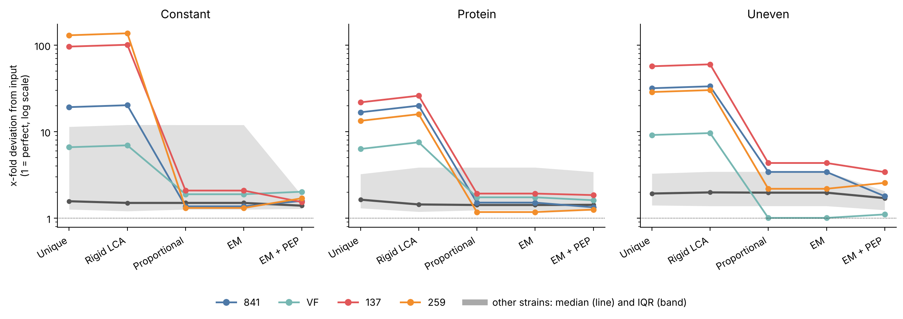
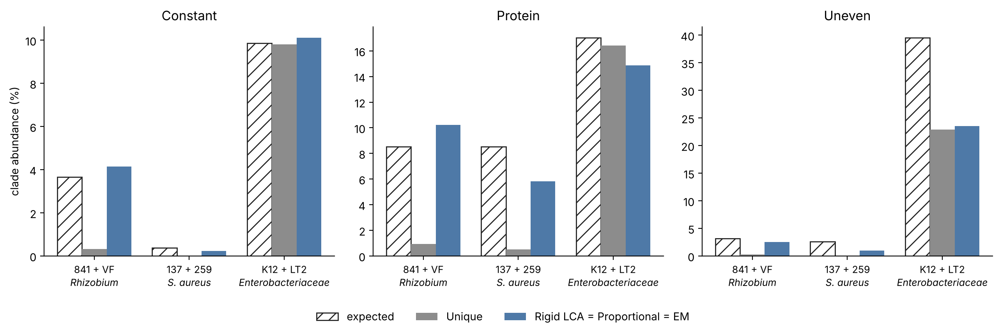
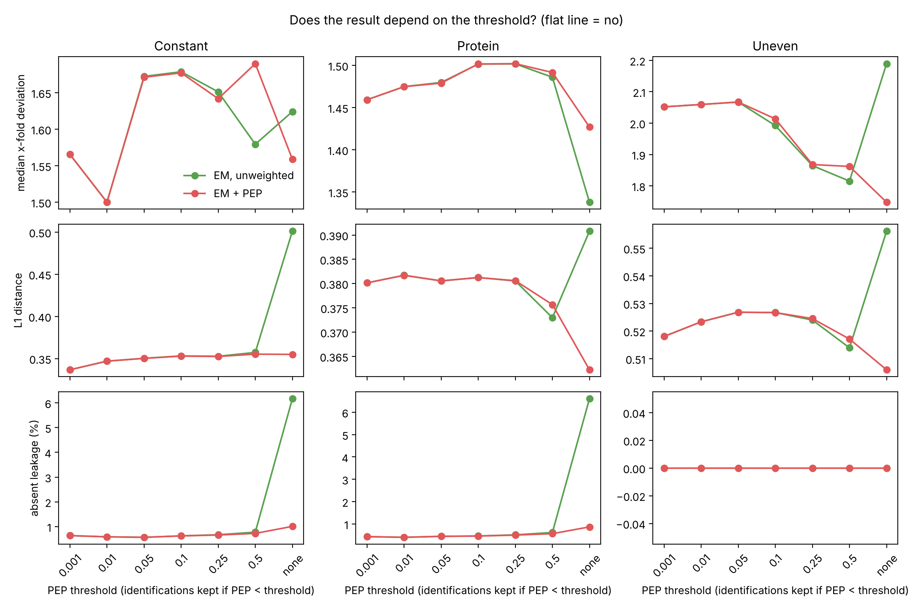
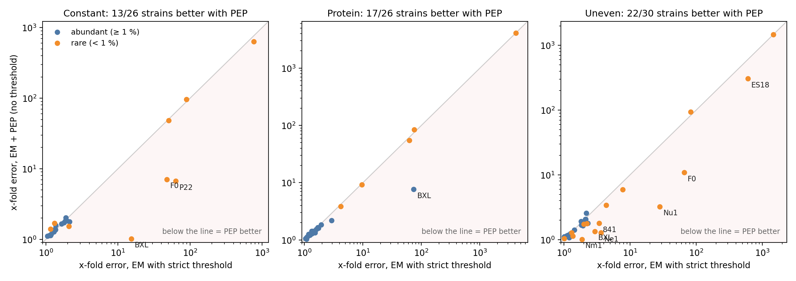
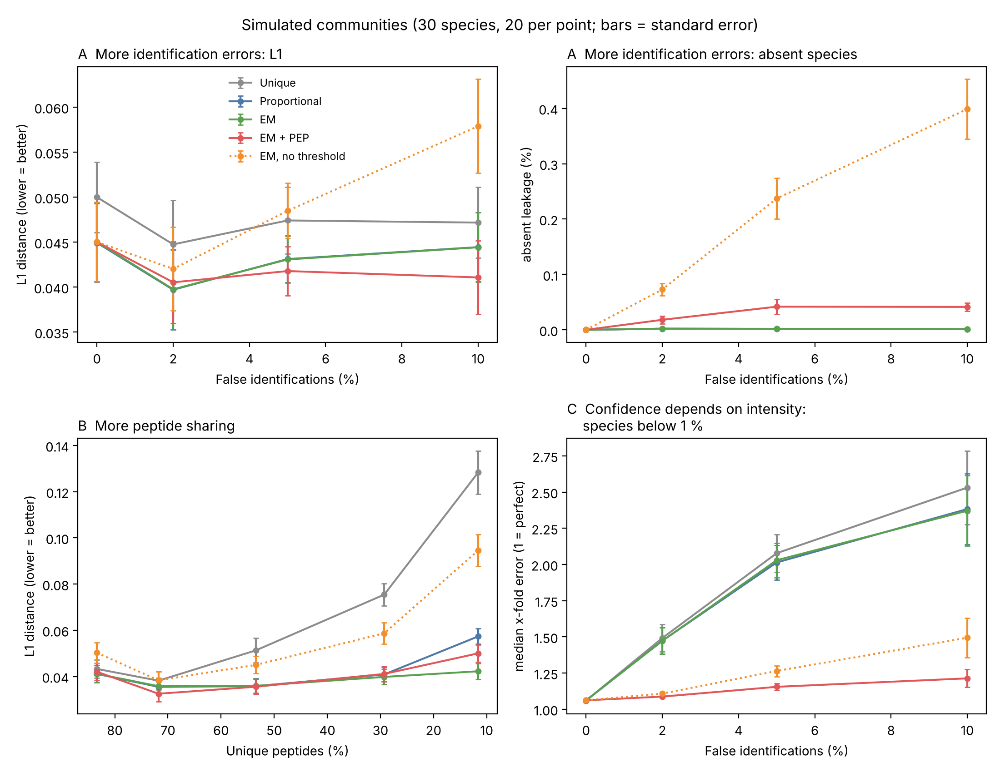

# 4. Results

## 4.1 Splitting among strains

Among identifications with PEP \< 0.01, 8 % of the intensity maps to more than one strain, and 99 % of that shared signal belongs to three strain pairs: 841 + VF, 137 + 259 and K12 + LT2. Only four strains obtain more than half of their signal from shared peptides: 841, VF, 137 and 259 (Table S2).

Splitting the shared signal corrected these four strains and left the rest practically unchanged (Figure 2). Their median error was 15 to 45-fold with Unique and with Rigid LCA, depending on the design, and 1.6 to 2.7-fold with Proportional; all four improved in all three designs. In the other strains the change was not significant (Holm-corrected Wilcoxon, *p* ≥ 0.09). As a result, over all strains the difference between Unique and Proportional was not significant in any design, although the largest errors disappeared. EM gave the same estimates as Proportional in every design (difference in median error below 0.001 log₁₀ units). The metrics per arm are in Table S3 and the comparisons in Table S5.

::: {custom-style="Leyenda"}
**Figure 2.** X-fold deviation of the four sharing strains (coloured lines) and of the other strains (median and interquartile range, grey) under each arm. A deviation of 1 is a perfect estimate. Per-strain values are in Table S4.
:::

## 4.2 Internal nodes

At the internal nodes of the tree, Rigid LCA, Proportional and EM gave the same values, and the two clades formed by strain pairs were close to their expected value (Figure 3). Unique, in contrast, underestimated the *Rhizobium* clade 9 to 12-fold and the *Staphylococcus aureus* clade 17 to 109-fold. The Enterobacteriaceae clade was underestimated about 1.7-fold in Uneven by every arm, because LT2, the most abundant strain in that design, was itself underestimated. All node values are in Table S6.

::: {custom-style="Leyenda"}
**Figure 3.** Estimated abundance of the three clades that carry almost all of the shared signal, compared with the expected value. At these nodes, Rigid LCA, Proportional and EM give the same value.
:::

## 4.3 PEP weighting

At PEP thresholds up to 0.25, weighting or not by 1 − PEP gave the same result (Figure 4). The difference appeared when all identifications were used: without weighting, absent leakage rose above 6 %, and with weighting it stayed at about 1 %.

::: {custom-style="Leyenda"}
**Figure 4.** Effect of the PEP threshold on EM, without weighting (green) and with 1 − PEP weighting (red). "None" means that every identification was used (values in Table S7). Uneven has no absent strains, so the lower right panel stays at zero.
:::

EM + PEP without a threshold was significantly more accurate than EM with a strict threshold in Protein and Uneven, and non-inferior in both; in Constant there was no significant difference and non-inferiority could not be established (Table 2). In exchange, absent leakage rose from 0.4--0.6 % to 0.9--1.0 %. With EM, about 80 % of that signal belongs to a single strain, Nm1, and comes from high-confidence identifications. With EM + PEP, Nm1 is still the strain that receives the most signal (about half), and the rest is spread over the other three (Table S8).

::: {custom-style="Leyenda"}
**Table 2.** EM with a strict threshold (PEP \< 0.01) versus EM + PEP without a threshold. Significant differences in bold (paired Wilcoxon with Holm correction).
:::

| Design   | Median x-fold, EM | Median x-fold, EM + PEP | *p* | Absent leakage, EM → EM + PEP |
|----------|------|----------|-----------|------------------|
| Constant | 1.50 | 1.56     | 0.57      | 0.59 % → 1.01 %  |
| Protein  | 1.47 | 1.43     | **0.046** | 0.40 % → 0.87 %  |
| Uneven   | 2.06 | 1.75     | **0.004** | --               |

The gain was concentrated in low-abundance strains (Figure 5). In this exploratory analysis, 13 of the 16 strains in Uneven with an expected share below 1 % improved, and their median deviation fell from 3.5 to 1.8-fold (*p* = 0.002), whereas the 14 more abundant strains did not change significantly (*p* = 0.39). The result held when the four strains absent from the other designs were excluded (9 of 12 improved; *p* = 0.010). These *p*-values are uncorrected.

::: {custom-style="Leyenda"}
**Figure 5.** X-fold deviation of each strain with thresholded EM (x-axis) and with EM + PEP (y-axis). Points below the diagonal improve with PEP weighting; strains with an expected share below 1 % are shown in orange.
:::

On the standard table (FDR ≤ 1 %), the conclusions for arms 1--4 were the same, and EM + PEP did not differ from EM (*p* ≥ 0.13).

## 4.4 Changes between designs

Table 3 compares, for each pair of designs, the observed fold change of each strain with the expected one. The thresholded arms recovered the changes similarly, and EM + PEP gave the best agreement in the two contrasts involving Uneven. The direction of change of the four strains absent from Constant and Protein was recovered poorly by every arm, because their estimated abundance in Uneven (0.02--0.11 % with EM) is of the same order as the false signal they receive in the designs where they are absent.

::: {custom-style="Leyenda"}
**Table 3.** Recovery of fold changes between designs. Direction gives how many of the four strains absent from Constant and Protein changed in the correct direction (full results in Table S9).
:::

| Contrast            | Arm               | Pearson *r* | Spearman ρ | Median \|log₂ error\| | Direction (absent strains) |
|---------------------|-------------------|-------------|------------|-----------------------|----------------------------|
| Protein vs Constant | Unique            | 0.94        | 0.91       | 0.23                  | --                         |
|                     | Proportional / EM | 0.93        | 0.91       | 0.22                  | --                         |
|                     | EM + PEP          | 0.93        | 0.89       | 0.30                  | --                         |
| Uneven vs Constant  | Unique            | 0.92        | 0.75       | 0.80                  | 1/4                        |
|                     | Proportional / EM | 0.90        | 0.74       | 0.92                  | 1/4                        |
|                     | EM + PEP          | 0.94        | 0.78       | 0.68                  | 2/4                        |
| Uneven vs Protein   | Unique            | 0.70        | 0.64       | 0.80                  | 1/4                        |
|                     | Proportional / EM | 0.70        | 0.65       | 0.84                  | 2/4                        |
|                     | EM + PEP          | 0.78        | 0.70       | 0.49                  | 1/4                        |

## 4.5 Simulations

Figure 6 summarises the results on the simulated communities (Table 1).

::: {custom-style="Leyenda"}
**Figure 6.** Performance of the arms on the simulated communities (mean of 20 communities per point; bars: standard error). Rigid LCA is not shown because its error is off the scale. Panels A, B and C correspond to the studies in Table 1 (values in Tables S10 and S11).
:::

When the proportion of shared peptides was that of the mock community, Proportional and Unique gave similar results. As that proportion increased, Unique degraded and Proportional did not: with 12 % unique peptides, Proportional was better in all 20 communities (*p* \< 0.0001). Iterating the split improved the result only at that extreme (EM better in 17 of 20 communities; *p* = 0.0008) (study B).

Using all identifications without weights degraded the estimates as false identifications increased, whereas with PEP weighting the same input gave results similar to the strict threshold (study A). When the confidence of a correct identification did not depend on its intensity, the strict threshold removed almost all false identifications and few correct ones, and EM + PEP did not beat it: the L1 distance was similar and the median species error was slightly higher with 5 and 10 % false identifications (*p* ≤ 0.025). With many shared peptides (study B, 12 % unique peptides), EM + PEP was also somewhat worse than EM (*p* = 0.0003). When confidence depended on intensity (study C), the threshold discarded 21 to 35 % of correct identifications, mostly from low-abundance species. There, EM + PEP reduced the error of rare species from 2.0--2.4 to 1.2-fold, and the median error was lower in 19 or 20 of the 20 communities (*p* ≤ 0.0001).

In study D, the leaf-only and all-rank models gave the same genus totals. When 83 % of the peptides were unique, both models also agreed at the leaves. With 30 % unique peptides, however, the all-rank model kept part of the signal at the genus nodes, and the median species deviation increased from 1.07 to 3.4-fold. This error was larger in all 20 communities (*p* \< 0.0001). PEP weighting had the same effect on both models, with no significant difference from EM (Table S12).
